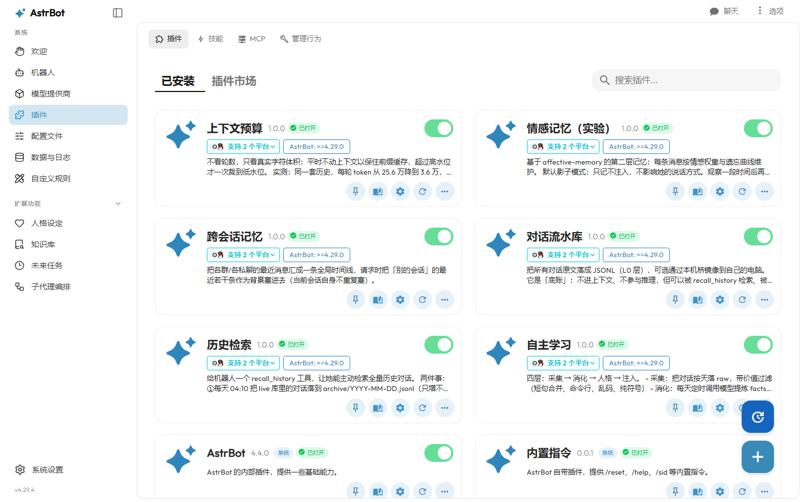
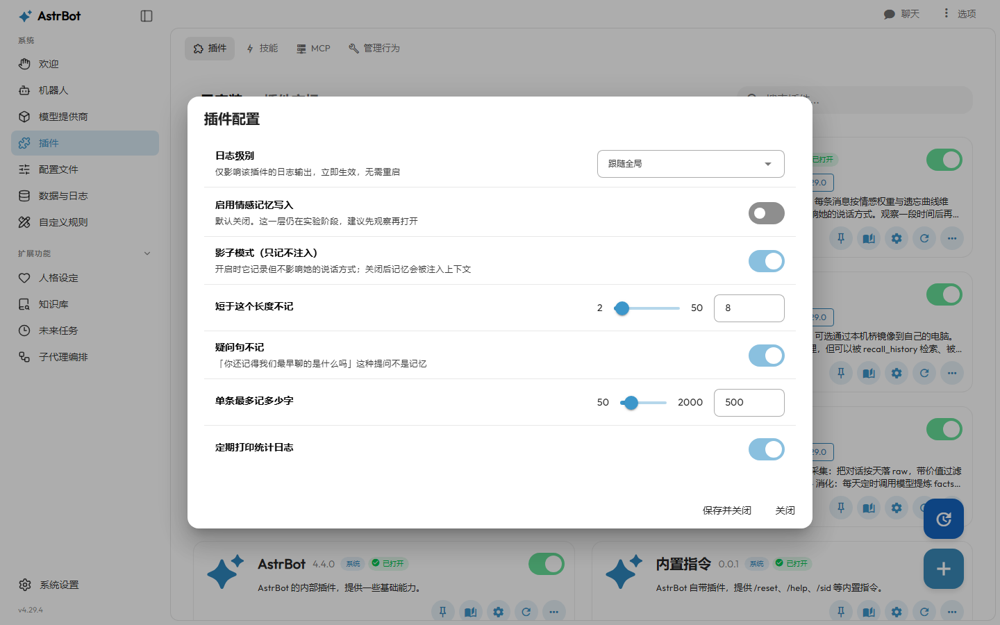

# Whale Mind

**Four-layer memory for AstrBot (and any LLM chatbot) — archiving, distillation, affect memory, and context budgeting.**
Cuts per-turn context from 256k to 36k tokens and lifts prompt-cache hit rate from 3% to 90%.

> Keywords: AstrBot plugin · LLM chatbot memory · long-term memory · context window management ·
> prompt caching · token cost optimization · Ollama · DeepSeek · QQ bot (OneBot / NapCat)

**给聊天机器人一套真正能用、还便宜的记忆。**
四层记忆结构 + 上下文预算，把每轮 token 从 25 万压到 3.6 万，缓存命中率 3% → 90%。

> 这是一个在真实环境里跑了两个月的方案，不是 demo。文档里所有数字都来自实测。

---

## 它解决什么问题

如果你用 AstrBot / 任意 LLM 机器人聊久了，一定会遇到这三件事：

1. **她记不住** —— 上次说的话，隔一天就忘。历史被框架的「只保留 N 轮」机制反复吃掉。
2. **越聊越贵** —— 上下文越长，每轮重发的 token 越多。实测单轮从 200 token 涨到 25 万，差 1000 倍。
3. **记忆是糊的** —— 把聊天记录整段塞回去，模型被噪声淹没，回复反而变差。

Whale Mind 的答案是：**分四层，每层只干一件事。**

```
L0 会话流水  ──  全量存档，永不进上下文（但可被检索）
L1 提炼记忆  ──  事实 / 风格，每轮只注入 5+3 条，≤1500 字
L2 情感记忆  ──  带权重与衰减的事件（实验中）
L3 工作上下文 ── 最近几十条对话，按体积滞回裁剪，保住前缀缓存
```

## 实测效果

同一套历史、同一个问题：

| | 改造前 | 改造后 |
|---|---|---|
| 每轮上下文 | 256,385 token | 36,219 token |
| 缓存命中率 | 3.0% | 90.5% |
| 单轮成本 | ¥0.25 | ¥0.004 |
| 每天 100 条 | ¥8.5 | ≈ ¥0.4 |

## 组件

| 组件 | 作用 | 类型 |
|---|---|---|
| `recall_history` | 每日归档 + 主动检索历史，让她能「翻旧账」 | AstrBot 插件 |
| `memory_vault` | 全量对话流水落盘（L0），可镜像到本机 | AstrBot 插件 |
| `self_study` | 从流水里提炼事实与说话风格（L1），定时消化 | AstrBot 插件 |
| `context_budget` | 按字符体积滞回裁剪上下文，保住前缀缓存 | AstrBot 插件 |
| `emotion_memory` | 情感权重 + 遗忘曲线（L2，影子模式） | AstrBot 插件 |
| `global_memory` | 跨群/跨私聊的「别处说过的话」 | AstrBot 插件 |
| `dsh-whale-memory` | 在 DSH 侧栏展示记忆星图 | DSH 插件 |
| `dsh-memory-galaxy` | 星图渲染页（同源 iframe，可单独打开） | DSH 插件 |

## 界面

插件在 AstrBot 面板里的样子（下面的数据来自一个**完全虚构的演示实例**，不是任何人的真实对话）：



每个插件的配置项由 `_conf_schema.json` 描述，面板会直接渲染成表单——不用改 JSON，
也不用读源码才知道某项填什么：



## 快速开始

### 1. 安装插件

**方式 A：一键安装（推荐，Windows）**

从 [Releases](https://github.com/ZiXianXie/WhaleMind/releases) 下载 `whale-mind-0.1.0-installer.zip`，解压后双击 `安装WhaleMind.bat`：

- 自动在 C/D/E/F/G 盘、用户目录、桌面、下载目录里找 AstrBot
- 找不到会让你把 AstrBot 文件夹拖进窗口
- 同名插件存在时先备份成 `xxx.bak_日期时间`，不会直接覆盖
- 不联网、不上传任何东西

**方式 B：手动拷贝**

把 `plugins/` 下需要的目录整个拷进 AstrBot 的插件目录：

```
<AstrBot>/data/plugins/astrbot_plugin_context_budget/
<AstrBot>/data/plugins/astrbot_plugin_recall_history/
...
```

重启 AstrBot，日志里应出现 `Loading plugin astrbot_plugin_xxx`。

### 2. 最小配置

每个插件的配置都在 `<AstrBot>/data/plugin_data/<插件名>/config.json`，首次启动会自动生成。

`context_budget` 最关键：

```json
{
  "enabled": true,
  "high_chars": 60000,
  "low_chars": 40000,
  "keep_last": 8,
  "strip_images": true,
  "image_keep": 2
}
```

含义：上下文超过 6 万字符就一次裁到 4 万（留 2 万缓冲），最近 8 条永远保留。

### 3. 验证

问她一句：「你还记得我们最早聊的是什么吗？」
她应该调用 `recall_history` 去翻归档，而不是回答「不记得了」。

## 测试

```bash
pip install -r requirements-dev.txt
python -m pytest            # 54 passed
```

覆盖：上下文裁剪的滞回逻辑、归档检索的切词与截断、消化层的过滤/切分/时间戳规范化、
以及跨会话记忆与情感记忆的准入判断。CI 在 Ubuntu 与 Windows 上各跑一遍（Python 3.10 / 3.12），
外加一个结构检查 job：确认每个插件的 `metadata.yaml`、`_conf_schema.json` 齐全且 `main.py` 可编译。

测试的设计取舍写在 [`tests/README.md`](tests/README.md)：用桩件模拟 AstrBot 运行时，
所以**不覆盖**真实宿主生命周期、网络调用与前端渲染。

## 三个用钱换来的教训

这部分比代码更值钱，详细推导见 [`docs/architecture.md`](docs/architecture.md)：

1. **永远不要往 system prompt 末尾塞「每轮都变」的内容** ——
   命中率 6–13% vs 92.6–93.9%，差 7 倍。
2. **按「轮数」压缩历史是错的** —— 一条长消息就能顶到 25 万 token。
   要按字符体积 + 滞回，让前缀尽可能长时间保持不变。
3. **「提炼」和「原话」必须是两个文件** ——
   否则记忆库里会塞满「你还记得我们最早聊的是什么吗」这种提问。

## 目录结构

```
whale-mind/
├── plugins/            # AstrBot 插件（Python）
├── packages/           # DSH 前端插件（JS）
├── docs/               # 架构、配置、FAQ、截图
├── examples/           # 示例配置与演示数据
├── tests/              # 54 条单元测试（pytest）
└── tools/              # 演示实例与截图辅助脚本
```

## 兼容性

- AstrBot **4.29.x**（插件 API 在 4.29 之后有变动，4.2x 早期版本未测试）
- Python 3.10+
- Windows / Linux 均可（路径全部相对于插件安装位置，不含绝对路径）
- 模型：任何 OpenAI 兼容接口；实测 DeepSeek 与本地 Ollama(qwen3:8b)

## 与 AstrBot 插件市场规范的对齐

按官方 [发布插件](https://docs.astrbot.app/dev/star/plugin-publish.html) 与
[插件配置](https://docs.astrbot.app/dev/star/guides/plugin-config.html) 文档：

- 每个插件目录都有 `metadata.yaml`（`name / display_name / desc / version / author / repo / astrbot_version / tags`）
- 仓库根目录有 `.gitignore`，排除 `__pycache__`、`node_modules`、运行时数据与密钥
- 打包体积远小于市场 **16MB** 限制（整仓约 0.65MB，其中图片 0.3MB；单个插件 16–300KB）
- 六个插件都带 `_conf_schema.json`，面板会直接渲染成表单（见上方截图）

## 许可

MIT。第三方组件与出处见 [THIRD_PARTY_NOTICES.md](THIRD_PARTY_NOTICES.md)。

## 致谢

- [AstrBot](https://github.com/AstrBotDevs/AstrBot) —— 插件宿主
- [affective-memory](https://github.com/mirageyuza/affective-memory) —— L2 情感记忆的算法来源
- [dsh-Memory-Galaxy](https://github.com/leesingx/dsh-Memory-Galaxy) —— 记忆星图的视觉原型
